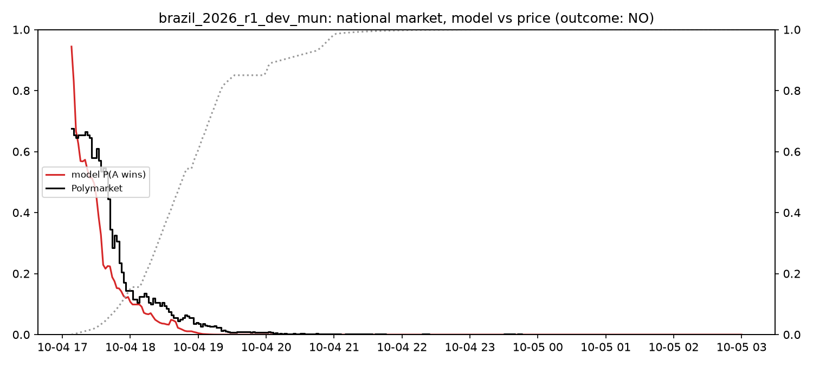
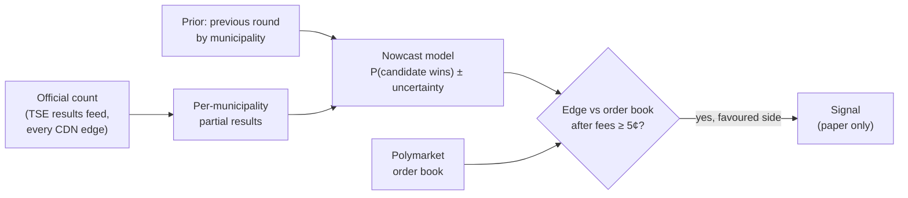

# Does Polymarket under-price public information?

On election night the official count is public, free, and updated every few seconds, yet a prediction
market can still sit far from what that count implies. This project measures how far, for how long,
and whether any of it can actually be traded. It has three parts:

1. **Brazil 2026 case study.** The presidential election (first round 4 Oct, runoff 25 Oct; Lula beat
   Flávio Bolsonaro 51.79–48.21), using the official count down to each of 499,206 polling sections
   and the minute each one reached the electoral court.
2. **Cross-category tests.** Which kinds of Polymarket markets (11 categories, 69,828 resolved markets)
   mis-weight information, tested out of sample with the tests fixed in advance.
3. **An election-night tool** (`brunder night`) that turns the live count into a calibrated
   probability and compares it with the order book, replayable on past nights and runnable live.

## What I found

Every result is labelled by how much it can be trusted: **in-sample** (settings chosen on the same
data), **pre-registered** (tests fixed and hashed before the data was examined), **forward** (recorded
live, before outcomes existed).

| finding | evidence |
|---|---|
[removed: figure derived from unlicensed third-party data]
| On the first-round night a municipality-level model was sure of the national result **28 minutes before the market** (up to ~3 hours in some state markets); 7 trade signals, 71% won, +16.6% per $. | **in-sample** (development night) |
| …but only **$2,741** could actually have been bought at those prices within 30 minutes, 98% of it in one market in its first ~4 minutes. | in-sample, from real trades |
| Across categories, **thin markets over-react to sharp moves and revert**: significant in 6 of 10 categories after multiple-testing correction, same sign in all 10. | **pre-registered**, held-out data |
| "Mentions" markets (what will X say) under-price near-certain outcomes: +2.1% per $ after spread and fees, but only $8.3k fillable across 1,851 entries. | **pre-registered**, held-out data |
| Deep markets reacting too slowly in general: **not supported**. Brazil's lag is a case, not a pattern this sample detects. | pre-registered (null) |

**The short version:** the information gap on count night is real and measurable, but the money
in it is small and gone within minutes. The cross-market pattern that holds up out of sample is
over-reaction in thin markets, not under-reaction in deep ones.


*First round, "Will Lula win the most votes?" (resolved NO). Red: the model from the live count;
black: Polymarket; dotted: share of sections counted. Brasília time. In-sample.*

## How the election-night tool works



Validation, from weakest to strongest; each step is done or scheduled:

| step | what it shows | status |
|---|---|---|
| replay the first round | the method can work; settings chosen here | done (in-sample) |
| capacity from real trades | how many dollars the signals could have bought | done: $2.7k in 30 min |
| rehearsal: live code against a simulated feed and CDN | the live system keeps up and matches the replay | done: same 7 signals, view of the count ~47 s behind truth (median), under assumed CDN cache/rate limits |
| 7 frozen replays: runoff + 6 governor runoffs | the method on races it was not built on | registered; waiting for the electoral court to publish section files |
| forward test | a true out-of-sample result | cross-category recorder live since 26 Oct; next election nights being recorded |

## Documents

| document | contents |
|---|---|
| [docs/writeup.md](docs/writeup.md) | **start here:** the whole project as a short article |
| [docs/research_design.md](docs/research_design.md) | Brazil case study: design, hypotheses, model math |
| [docs/cross_category.md](docs/cross_category.md) | cross-category method and pre-registered results; forward test |
| [docs/edge_tool.md](docs/edge_tool.md) | election-night tool: validation, capacity, registered replays, fast feed, recordings |
| [docs/data_requests.md](docs/data_requests.md) | data requested from third parties and their status |
| [prereg/NOTES.md](prereg/NOTES.md) | what each registration does and does not guarantee; recording log |
| [deploy/](deploy/) | always-on host: recorder, watchers, scheduled election-night recordings |

## Setup

```sh
uv sync                      # Python 3.13, deps from uv.lock
uv run brunder --help
```

## Data collection

```sh
uv run brunder elections                                   # TSE election codes (6257 = 2026 R1, 6258 = R2)
uv run brunder tse-snapshot --ele 6258 [--resume]          # full live-feed tree: national, 27 UFs + abroad, 5,757 municipalities
uv run brunder tse-watch --ele <code>                      # record a count as it happens (state-first, via brunder.feed)
uv run brunder tse-build --ele 6258                        # → data/processed/ele2026/e6258_c1/{votes,progress,municipalities}.parquet
uv run brunder tse-open votacao_candidato_munzona 2022     # certified results (priors / transfer estimation)
uv run brunder pm-search "brazil presidential"
uv run brunder pm-download brazil-presidential-election    # markets, 1-min prices, every trade
```

`data/raw/tse_live` cannot be re-downloaded once TSE takes the cycle down (2022 is already gone)
— back it up outside git. Everything else is reproducible from the commands above.

Where `data/` lives: on the author's laptop `data` is a symlink to an external SSD
(`/Volumes/Untitled/brunder-data`, with its own README and a `MANIFEST.sha256`; check integrity with
`cd /Volumes/Untitled/brunder-data && shasum -a 256 -c --quiet MANIFEST.sha256`). With the drive
unmounted the symlink dangles and data reads fail. Elsewhere, set `BRUNDER_DATA=/path/to/data` or
keep a plain `data/` directory. On the always-on VM it is `/srv/brunder/repo/data` (see `deploy/`).
The TSE CDN rate-limits (429) per client; live reads go through `brunder.feed`, which budgets requests
(see [docs/edge_tool.md](docs/edge_tool.md#reading-the-feed-fast-brunderfeed)).

## Election night

```sh
uv run brunder bweb 2026 1                                  # section-level BU-web files (receipt times + votes)
uv run brunder night replay configs/<config>.toml           # replay a past count against Polymarket prices
uv run python analysis/night_replay.py configs/<config>.toml   # replay + evaluation, logged per config id
uv run brunder stage configs/<config>.toml /tmp/stage       # registered configs: verified local copy of every input…
BRUNDER_DATA=/tmp/stage uv run python analysis/night_replay.py configs/<config>.toml   # …required before the one look
uv run brunder night live configs/<config>.toml             # live: model vs order books every 5 s (paper only)
```

## Library

| Module | Purpose |
|---|---|
| `brunder.tse_live` | live-feed archive / watch / parse (votes per unit, per-municipality completion time) |
| `brunder.tse_open` | TSE open-data downloads; `votes_by_municipality(year, cargo)` |
| `brunder.bweb` | section-level BU-web results: receipt time and votes per polling section, presidential and governor |
| `brunder.feed` | low-latency TSE feed reader: per-edge HTTP/2, newest copy across CDN edges, request budget, latency log |
| `brunder.night` | election-night engine: live (municipal or state model vs order books) and replay; evaluation |
| `brunder.statecast` | state-level count model with a national-swing prior (superseded for replay by `nowcast`) |
| `brunder.transfer` | first-round → runoff vote-transfer model (H1) |
| `brunder.polymarket` | Gamma events, CLOB price history + books, data-api trades |
| `brunder.nowcast` | count-progress model → P(win), national or per state (`uf=`) |
| `brunder.edge` | model-vs-market alignment, crossing delays, lead–lag, scores, cost-aware backtest, Kelly |
| `brunder.microstructure` | wallet concentration, flows, wash round-trips, price-impact persistence, capacity |
| `brunder.universe` | category × week sampled universe of resolved markets; 5-min price paths; pre-signal volume; fill checks |
| `brunder.pit` | point-in-time rules: `asof`, execution delay, embargoed discovery/holdout split, taker cost |
| `brunder.studies` | observation builder and the study kinds (`shock_drift`, `favourite_tilt`, `late_certainty`) |
| `brunder.stats` | event-cluster bootstrap, Holm and Benjamini–Hochberg |
| `brunder.registry` | pre-registration and the holdout vault |
| `brunder.verify` | price-history point-in-time check against trades |
| `brunder.live` | forward-test recorder: discovery, book polling, live signals, book-walk fills, gated verdict |

## Analyses

`analysis/r2_night.py` — runoff count: reconstructed nowcast vs the Polymarket "Lula wins" price,
for τ ∈ {0.005, 0.01, 0.02}. Writes `results/r2_night.png`, `results/r2_night_summary.csv`,
`results/r2_nowcast_tau*.csv`.

`analysis/calibrate_tau.py` — calibrates τ on the 2026 R1 count (prior: 2022 R1, needs
`brunder tse-open votacao_candidato_munzona 2022`), checks it on the runoff. → `results/tau_calibration*.csv`

`analysis/flows.py` — wallet flows, concentration, PnL to resolution, wash/self-trade checks and
price-impact persistence for the Lula/Flávio winner markets. → `results/flows_*.csv`

`analysis/figures.py` — paper figures from the outputs above → `results/fig1…fig6_*.png`.

## Cross-category workflow

```sh
uv run brunder universe all              # sample events per category × week; fetch 5-min price paths (resumable)
uv run brunder verify                    # price-history points vs trades (point-in-time check)
uv run brunder observations              # shocks / horizon observations / label-conflict flags
uv run brunder study prereg/<spec>.toml  # discovery split, run at will
uv run brunder register prereg/<spec>.toml          # spec must be committed; records its hash
uv run brunder study prereg/<spec>.toml --split holdout   # opens only for registered, unchanged specs; every look is logged
uv run brunder live run prereg/forward_v1.toml            # forward test: live signals + order books (run detached)
uv run brunder live status prereg/forward_v1.toml         # counts only; not a look
uv run brunder live evaluate prereg/forward_v1.toml       # one verdict, after the spec's stopping rule
```
