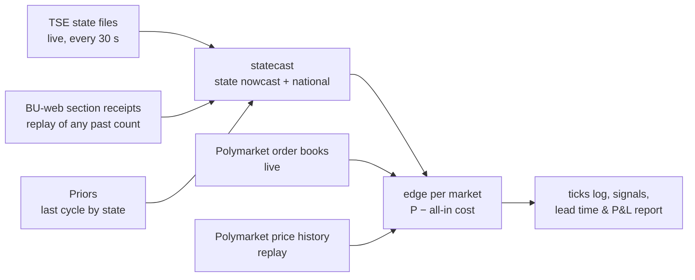

# Election-night edge tool (`brunder night`)

A tool that turns the paper's finding — prediction markets track the raw count, not the count
corrected for which areas report first — into a measurable, executable edge.

## What it does

- **Model** (`brunder.statecast`): per-state shrinkage nowcast for a share (runoff, > ½) or a
  margin (plurality, A − B > 0), with state-specific and shared national uncertainty. Validated on
  the archived 2026 R1 cross-section at 1.7% counted: +0.28 pt vs −2.97 pt for the raw count.
- **Edge**: for every configured market (national winner, "1st place in <state>"), expected profit
  per share of buying YES or NO at its all-in cost: book-walk average price including the market's
  own taker fee (live), or price + half-spread + fee (replay).
- **Replay** (`brunder night replay <config>`): rebuilds a past count from per-section receipt times
  (`brunder bweb`), with a receipt → publication lag calibrated against archived state files.
- **Live** (`brunder night live <config>`): polls the state files, recomputes, prints edges and logs
  every tick to `data/night/<config>/ticks.jsonl`. Paper only; nothing is traded.

## How it is validated

1. **Out of sample by construction:** priors come from the previous cycle; model parameters come from
   cross-cycle data, never from the count being scored.
2. **Replay before live:** every claim about lead time or P&L comes from a replay on official section
   data (`night.evaluate`: when model and market each settle on the winner, and the return of the
   first ≥ min-edge entry held to resolution, net of costs).
3. **Forward record:** live ticks are timestamped before outcomes exist; together with the
   cross-category forward test (`prereg/forward_v1.toml`) they form the track record.

## Using it on a new election

1. Write `configs/<election>.toml`: TSE cycle/election code, race type, candidate numbers, prior
   source, Polymarket market slugs (YES = candidate A wins).
2. `brunder night replay` on the previous comparable count, to calibrate τ and check the lead.
3. On the night: `brunder tse-watch` (state-first recorder, failure-tolerant) and
   `brunder night live` side by side, run detached.

## Development results: 2026 first round (`configs/brazil_2026_r1_dev_mun.toml`)

Section-level replay from BU-web receipts (499,206 sections; totals match TSE exactly). Publication
lag calibrated against the archived 17:26 BRT state files: **0 minutes** (15 of 7,686 domestic sections
off), i.e. a section appears in its state file when TSE receives it. Doing this exposed a parser bug:
the Acre, Amazonas, Rondônia, Roraima, Mato Grosso and Mato Grosso do Sul files stamp times in local
time (UTC−5/−4); fixed in `tse_live.UTC_OFFSET_H`.

What development taught (all in-sample, all decided on this set):
1. A **state-level** model is biased through the count: within states, later sections were more pro-Lula
   (mean z +3.5 to +6 for every τ). The **municipal** model (`brunder.nowcast`, top-two share) fixes it.
2. A prior from the previous cycle must carry national-swing uncertainty, and nothing trades until 1%
   of a market's sections are counted: the tool trades the count, not the prior.
3. τ = 0.015 (two-party share): 93% of 90% intervals cover the final result between 1% and 95% counted.
4. Only buy the side the model favours: long-shot buys on tail probabilities lost every time.

| | lead of model over market settling ≥ 0.9 (min) | gated, favoured-side signals |
|---|---|---|
| national (Flávio first) | 28 | NO, +127% |
| Piauí, Pará, Amapá, Amazonas | 194, 182, 168, 48 | YES: +15%, +18%, +133%, +24% |
| Minas Gerais, Tocantins | 20, 10 | YES: −100%, −100% |
| all 28 markets | median 0, mean 18 | 7 signals, 71% hit, +16.6% per $ (in-sample) |

## Pre-specified replay: 2026 runoff (`configs/night_r2_v1.toml`, registered)

Settings frozen and registered (`prereg/registry.jsonl`, commit 0ab6748) on 2026-10-26, before the
runoff BU-web files were published. **This is not a blind holdout.** When it was registered we already
knew the runoff outcome, all 27 state winners and final totals, the market's price path, Poliwave's
national raw-count path, and an earlier reconstructed runoff nowcast. The only input not yet seen is
the section-level receipt timing. What registration guarantees is that the model, τ and trading rules
cannot be retuned on that timing; it does not make the runoff an out-of-sample test of the idea.

Primary results: (1) national lead in minutes; (2) mean net return per $ of gated, favoured-side
signals across 28 markets (fees 0 on these markets, 1¢ half-spread). `brunder bweb 2026 2 --wait`
downloads the files when TSE publishes them; then
`uv run python analysis/night_replay.py configs/night_r2_v1.toml` runs it once and logs the look.

A genuine forward test needs the next election: a config registered before polls open, and the count
recorded live (`brunder tse-watch`) with `brunder night live` logging model and market as it happens.

### Proxy replays: the six governor runoffs of the same night (`configs/governor_r2/`, registered)

AC, AM, DF, ES, RN and TO held governor runoffs on 25 Oct 2026, each with a resolved Polymarket
winner market. Each config copies night_r2_v1's settings unchanged (municipal model, τ = 0.015, 1%
gate, favoured side only, 5¢ minimum edge); the prior is that race's own first round by municipality;
A is the first-round leader (who won in four states and lost in RN and TO). The method was never
developed on governor races, and neither the count paths nor the intra-night price paths have been
examined, so these test the *method* on races it was not built on (outcomes known, so not blind).
They run from the same runoff BU-web files (now parsed with governor rows) as soon as TSE publishes
them. Together with the presidential runoff: 7 races scored once each.

Considered and set aside: Brazil 2022 presidential (Polymarket price history no longer served),
São Paulo mayor 2024 (market's candidate labels don't map cleanly to outcomes; zone-level units
needed), 2026 governor first rounds (multi-candidate outright-majority races need a different prior).

### How the 7 runoff replays will be read (written 2026-10-26, before any result exists)

They are a **method sanity check, not an edge estimate.**
- Not independent: all seven races share one night, one publication system and partly one national
  swing; the presidential and governor counts arrive in the same sections.
- Tiny trade sample: at most one gated, favoured-side entry per race (≤ 7 trades), in markets with
  $27k–$161k lifetime volume. A mean return over ≤ 7 bets is dominated by one or two outcomes.

Primary, in this order:
1. **Settle lead:** minutes between the model and the market each staying ≥ 0.9 on the eventual
   winner, per race (positive = model first). Reported for all 7 with the median.
2. **Calibration of P along the count:** share of ticks (1–95% counted) whose 90% interval contains
   the final share, and mean z, per race and pooled. Tells whether τ = 0.015 transfers from the
   presidential first round to new races.

Reported but **not** used for any claim: P&L of the gated signals, and hit rate. **No edge claim will
rest on P&L from these replays**, whichever way it comes out. An edge claim needs the forward record:
live, pre-registered, with book-walk fills (`forward_v1`, `brunder night live` on the next election).

What would count against the method: a negative median settle lead, or 90% intervals covering the final
share well below ~80% of ticks in most races. Either is reported as such, without re-tuning these
frozen configs.

## Reading the feed fast (`brunder.feed`)

Every live forecaster reads the same public TSE feed (`resultados.tse.jus.br`). The delays between a
section reaching TSE and the market moving, measured 2026-10-26:

| stage | delay | what the tool does |
|---|---|---|
| section received → in its state's files | ≈ 0 (15 of 7,686 sections off) | reads state progress + municipality files, never waits for the national file |
| state file → national aggregate | up to ~75 s | same |
| file generated → visible at a CDN edge | up to the edge's cache life (~60 s off-night; nine edges with 9–57 s left at one moment); query-string cache-busting is ignored | reads 1–3 edges per file, rotated each tick, keeps the highest `idg`; logs each read's age (fetch time − file's own `dg`/`hg`) to `latency.jsonl` |
| count → what it implies | minutes to hours (R1 replay) | the municipal model |

**Transport:** one HTTP/2 client per edge (29 state files: 0.12 s per pass on one edge vs 0.45 s over
HTTP/1.1; a single shared client serialised nine edges to 1.5–3 s). Conditional requests (ETag): an
unchanged file costs a 304 with no body.

**The rate limit is the binding constraint.** Akamai answers 429 per client: an unbudgeted fan-out
(~50k requests in two minutes) and then a 40 s run peaking at 40 req/s were both locked out; the lockout
lasted under 2 minutes (`logs/tse_throttle_probe.log`). So all reads share one adaptive limiter (start
5 req/s, +0.05 per clean response up to 10, halve and pause 30 s on any 429), and each live tick splits
its budget: ~30% fans out the progress files, ~70% reads the municipalities that changed, most newly
counted sections first; the rest wait for the next tick (`mun_backlog` in `ticks.jsonl`). The tool does
not evade the limit (no IP rotation or proxies).

## Roadmap (project)

| step | what | status |
|---|---|---|
| 1 | Replay 2026 R1 on official section data | done (development) |
| 2 | Replay 2026 R2 with the frozen config (pre-specified, outcomes known) | registered; waiting for TSE to publish |
| 3 | Live municipal mode over the fast feed (`brunder.feed`, `night.MunTracker`) | done; smoke-tested on the final runoff feed |
| 4 | Capacity: replay entries against archived trades; live book-walk at $25/$100/$500 | next |
| 5 | Second feed adapter (another country with a public live-results feed and Polymarket markets) | later |
| 6 | Write-up: paper (Brazil) + short post (method, replay chart, forward record) | after step 2 |
| 7 | Forward test on the next election with live markets: config registered before polls open | when one is scheduled |
