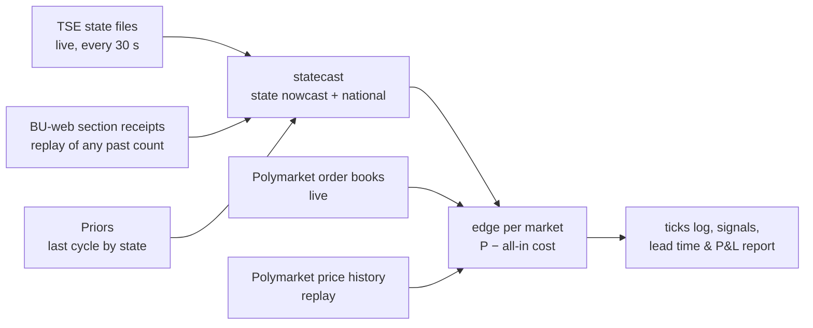

# Election-night edge tool (`brunder night`)

A tool that turns the paper's finding — prediction markets track the raw count, not the count
corrected for which areas report first — into a measurable, executable edge.

## What it does

- **Model** (`brunder.statecast`): per-state shrinkage nowcast for a share (runoff, > ½) or a
  margin (plurality, A − B > 0), with state-specific and shared national uncertainty. Validated on
  the archived 2026 R1 cross-section at 1.7% counted: +0.28 pt vs −2.97 pt for the raw count.
- **Edge**: for every configured market (national winner, "1st place in <state>"), expected profit
  per share of buying YES or NO at its all-in cost: book-walk average price including the market's
  own taker fee (live), or price + half-spread + fee (replay).
- **Replay** (`brunder night replay <config>`): rebuilds a past count from per-section receipt times
  (`brunder bweb`), with a receipt → publication lag calibrated against archived state files.
- **Live** (`brunder night live <config>`): polls the state files, recomputes, prints edges and logs
  every tick to `data/night/<config>/ticks.jsonl`. Paper only; nothing is traded.

## How it is validated

1. **Out of sample by construction:** priors come from the previous cycle; model parameters come from
   cross-cycle data, never from the count being scored.
2. **Replay before live:** every claim about lead time or P&L comes from a replay on official section
   data (`night.evaluate`: when model and market each settle on the winner, and the return of the
   first ≥ min-edge entry held to resolution, net of costs).
3. **Forward record:** live ticks are timestamped before outcomes exist; together with the
   cross-category forward test (`prereg/forward_v1.toml`) they form the track record.

## Using it on a new election

1. Write `configs/<election>.toml`: TSE cycle/election code, race type, candidate numbers, prior
   source, Polymarket market slugs (YES = candidate A wins).
2. `brunder night replay` on the previous comparable count, to calibrate τ and check the lead.
3. On the night: `brunder tse-watch` (state-first recorder, failure-tolerant) and
   `brunder night live` side by side, run detached.

## Development results: 2026 first round (`configs/brazil_2026_r1_dev_mun.toml`)

Section-level replay from BU-web receipts (499,206 sections; totals match TSE exactly). Publication
lag calibrated against the archived 17:26 BRT state files: **0 minutes** (15 of 7,686 domestic sections
off), i.e. a section appears in its state file when TSE receives it. Doing this exposed a parser bug:
the Acre, Amazonas, Rondônia, Roraima, Mato Grosso and Mato Grosso do Sul files stamp times in local
time (UTC−5/−4); fixed in `tse_live.UTC_OFFSET_H`.

What development taught (all in-sample, all decided on this set):
1. A **state-level** model is biased through the count: within states, later sections were more pro-Lula
   (mean z +3.5 to +6 for every τ). The **municipal** model (`brunder.nowcast`, top-two share) fixes it.
2. A prior from the previous cycle must carry national-swing uncertainty, and nothing trades until 1%
   of a market's sections are counted: the tool trades the count, not the prior.
3. τ = 0.015 (two-party share): 93% of 90% intervals cover the final result between 1% and 95% counted.
4. Only buy the side the model favours: long-shot buys on tail probabilities lost every time.

| | lead of model over market settling ≥ 0.9 (min) | gated, favoured-side signals |
|---|---|---|
| national (Flávio first) | 28 | NO, +127% |
| Piauí, Pará, Amapá, Amazonas | 194, 182, 168, 48 | YES: +15%, +18%, +133%, +24% |
| Minas Gerais, Tocantins | 20, 10 | YES: −100%, −100% |
| all 28 markets | median 0, mean 18 | 7 signals, 71% hit, +16.6% per $ (in-sample) |

## Held-out test: 2026 runoff (`configs/night_r2_v1.toml`, registered)

Frozen and registered (`prereg/registry.jsonl`, commit 0ab6748) on 2026-10-26, before the runoff
BU-web files were published. Primary results: (1) national lead in minutes; (2) mean net return per $
of gated, favoured-side signals across 28 markets (fees 0 on these markets, 1¢ half-spread).
`brunder bweb 2026 2 --wait` downloads the files when TSE publishes them; then
`uv run python analysis/night_replay.py configs/night_r2_v1.toml` runs the test once and logs the look.

## Roadmap (project)

| step | what | status |
|---|---|---|
| 1 | Replay 2026 R1 on official section data | done (development) |
| 2 | Replay 2026 R2, frozen config | registered; waiting for TSE to publish |
| 3 | Live municipal mode (per-municipality files on the night; live mode is state-level today) | next |
| 4 | Capacity: replay entries against archived trades; live book-walk at $25/$100/$500 | next |
| 5 | Second feed adapter (another country with a public live-results feed and Polymarket markets) | later |
| 6 | Write-up: paper (Brazil) + short post (method, replay chart, forward record) | after step 2 |
