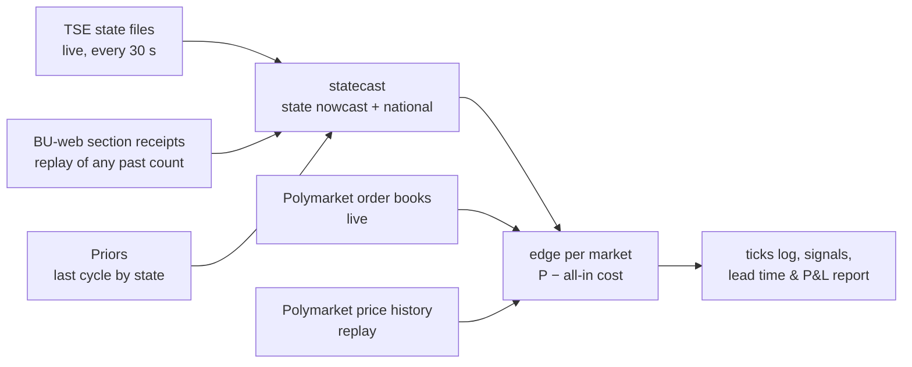

# Election-night edge tool (`brunder night`)

A tool that turns the paper's finding — prediction markets track the raw count, not the count
corrected for which areas report first — into a measurable, executable edge.

## What it does

- **Model** (`brunder.statecast`): per-state shrinkage nowcast for a share (runoff, > ½) or a
  margin (plurality, A − B > 0), with state-specific and shared national uncertainty. Validated on
  the archived 2026 R1 cross-section at 1.7% counted: +0.28 pt vs −2.97 pt for the raw count.
- **Edge**: for every configured market (national winner, "1st place in <state>"), expected profit
  per share of buying YES or NO at its all-in cost: book-walk average price including the market's
  own taker fee (live), or price + half-spread + fee (replay).
- **Replay** (`brunder night replay <config>`): rebuilds a past count from per-section receipt times
  (`brunder bweb`), with a receipt → publication lag calibrated against archived state files.
- **Live** (`brunder night live <config>`): polls the state files, recomputes, prints edges and logs
  every tick to `data/night/<config>/ticks.jsonl`. Paper only; nothing is traded.

## How it is validated

1. **Out of sample by construction:** priors come from the previous cycle; model parameters come from
   cross-cycle data, never from the count being scored.
2. **Replay before live:** every claim about lead time or P&L comes from a replay on official section
   data (`night.evaluate`: when model and market each settle on the winner, and the return of the
   first ≥ min-edge entry held to resolution, net of costs).
3. **Forward record:** live ticks are timestamped before outcomes exist; together with the
   cross-category forward test (`prereg/forward_v1.toml`) they form the track record.

## Using it on a new election

1. Write `configs/<election>.toml`: TSE cycle/election code, race type, candidate numbers, prior
   source, Polymarket market slugs (YES = candidate A wins).
2. `brunder night replay` on the previous comparable count, to calibrate τ and check the lead.
3. On the night: `brunder tse-watch` (state-first recorder, failure-tolerant) and
   `brunder night live` side by side, run detached.

## Roadmap (project)

| step | what | why |
|---|---|---|
| 1 | Replay 2026 R1 (first-place markets, 27 states + national) | first full test on official section data |
| 2 | Replay 2026 R2 when its BU-web files publish (`brunder bweb 2026 2 --wait` is running) | the paper's count-night result |
| 3 | Calibrate τ on R1, test on R2 (and the reverse) | uncertainty that has never seen the scored count |
| 4 | Capacity: replay entries against archived trades; live: book-walk at $25/$100/$500 | edge in dollars, not prices |
| 5 | Second feed adapter (another country with a public live-results feed and Polymarket markets) | shows the tool generalises beyond Brazil |
| 6 | Write-up: paper (Brazil) + short post (method, replay chart, forward record) | recruiting / LinkedIn |
