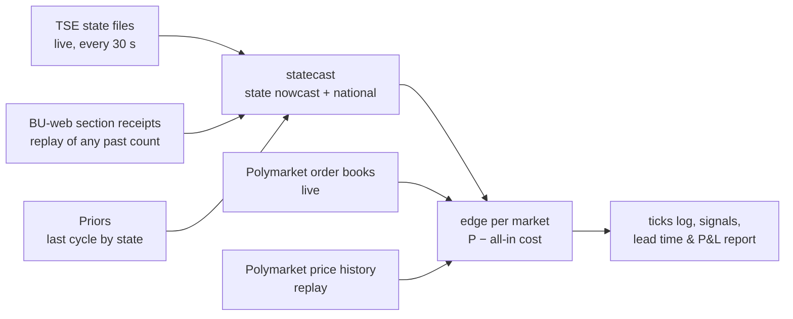
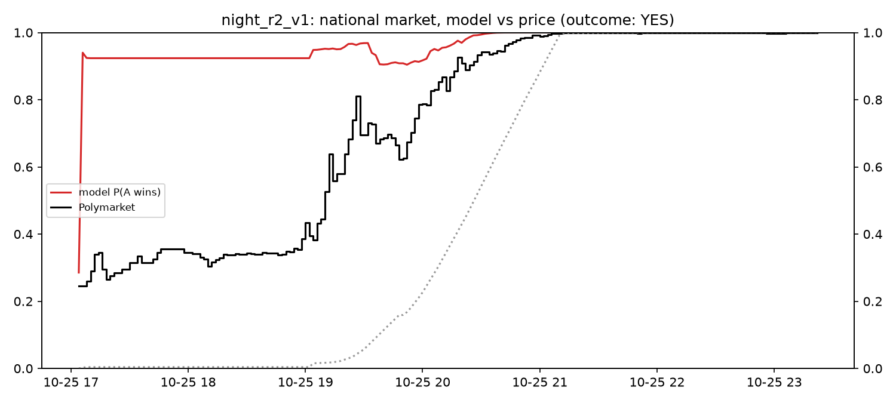

# Election-night edge tool (`brunder night`)

A tool that turns the paper's finding — prediction markets track the raw count, not the count
corrected for which areas report first — into a measurable, executable edge.

## What it does

- **Model** (`brunder.statecast`): per-state shrinkage nowcast for a share (runoff, > ½) or a
  margin (plurality, A − B > 0), with state-specific and shared national uncertainty. Validated on
  the archived 2026 R1 cross-section at 1.7% counted: +0.28 pt vs −2.97 pt for the raw count.
- **Edge**: for every configured market (national winner, "1st place in <state>"), expected profit
  per share of buying YES or NO at its all-in cost: book-walk average price including the market's
  own taker fee (live), or price + half-spread + fee (replay).
- **Replay** (`brunder night replay <config>`): rebuilds a past count from per-section receipt times
  (`brunder bweb`), with a receipt → publication lag calibrated against archived state files.
- **Live** (`brunder night live <config>`): polls the state files, recomputes, prints edges and logs
  every tick to `data/night/<config>/ticks.jsonl`. Paper only; nothing is traded.

## How it is validated

1. **Out of sample by construction:** priors come from the previous cycle; model parameters come from
   cross-cycle data, never from the count being scored.
2. **Replay before live:** every claim about lead time or P&L comes from a replay on official section
   data (`night.evaluate`: when model and market each settle on the winner, and the return of the
   first ≥ min-edge entry held to resolution, net of costs).
3. **Forward record:** live ticks are timestamped before outcomes exist; together with the
   cross-category forward test (`prereg/forward_v1.toml`) they form the track record.

## Using it on a new election

1. Write `configs/<election>.toml`: TSE cycle/election code, race type, candidate numbers, prior
   source, Polymarket market slugs (YES = candidate A wins).
2. `brunder night replay` on the previous comparable count, to calibrate τ and check the lead.
3. On the night: `brunder tse-watch` (state-first recorder, failure-tolerant) and
   `brunder night live` side by side, run detached.

## Development results: 2026 first round (`configs/brazil_2026_r1_dev_mun.toml`)

Section-level replay from BU-web receipts (499,206 sections; totals match TSE exactly). Publication
lag calibrated against the archived 17:26 BRT state files: **0 minutes** (15 of 7,686 domestic sections
off), i.e. a section appears in its state file when TSE receives it. Doing this exposed a parser bug:
the Acre, Amazonas, Rondônia, Roraima, Mato Grosso and Mato Grosso do Sul files stamp times in local
time (UTC−5/−4); fixed in `tse_live.UTC_OFFSET_H`.

What development taught (all in-sample, all decided on this set):
1. A **state-level** model is biased through the count: within states, later sections were more pro-Lula
   (mean z +3.5 to +6 for every τ). The **municipal** model (`brunder.nowcast`, top-two share) fixes it.
2. A prior from the previous cycle must carry national-swing uncertainty, and nothing trades until 1%
   of a market's sections are counted: the tool trades the count, not the prior.
3. τ = 0.015 (two-party share): 93% of 90% intervals cover the final result between 1% and 95% counted.
4. Only buy the side the model favours: long-shot buys on tail probabilities lost every time.
5. **Known weakness, found 2026-10-27 (before any runoff result):** the model is overconfident late in
   the count. National ticks, first round: 90% intervals contain the final share in 100% of ticks at
   80–90% counted, **63% at 90–95%**, 0% at 95–99%. The projection error shrinks (−29 → −20 → −6 bp)
   but the model's sd shrinks faster (23 → 12 → 2 bp): it treats a municipality's last sections like
   its earlier ones, and late sections differ (the within-municipality version of item 1). At 100%
   counted a 0.2 bp gap remains from 65 sections in municipalities absent from the prior. Little effect
   on trading (markets have settled by then); a direct effect on the calibration metric below.

| | lead of model over market settling ≥ 0.9 (min) | gated, favoured-side signals |
|---|---|---|
| national (Flávio first) | 28 | NO, +127% |
| Piauí, Pará, Amapá, Amazonas | 194, 182, 168, 48 | YES: +15%, +18%, +133%, +24% |
| Minas Gerais, Tocantins | 20, 10 | YES: −100%, −100% |
| all 28 markets | median 0, mean 18 | 7 signals, 71% hit, +16.6% per $ (in-sample) |

*First round, national market "Will Lula win the most votes in the first round?" (resolved NO: Flávio
finished first). Red: the model's P(YES) at each minute from section receipts; black: Polymarket price;
dotted (right axis): share of sections counted. Times are Brasília time (UTC−3); polls closed at 17:00.
Development set: settings were chosen on this night, so this is in-sample.*

### Capacity: what the first-round signals could actually have bought (`analysis/night_capacity.py`)

The returns above are per dollar at the quoted price, i.e. they assume unlimited size. For each gated
entry (favoured-side rule, 1-minute replay: 7 entries, 71% hit, +17.4% per $), the script sums
**taker** notional that traded on the entry's side at the entry price or better in the 5/30/120 minutes
after it, from Polymarket's taker-only trades (no look-ahead: only fills after the entry count). Trade
semantics were checked by hand against maker legs of the same transaction (a taker YES buy at 0.588
matched maker NO buys at 0.41/0.42; sizes sum), and one market's 30-minute total was re-added by hand.

| market | side | entry (UTC) | price | return/$ | fillable $ in 30 min |
|---|---|---|---|---|---|
| national | NO | 20:28 | 0.580 | +1.27 | 2,683 |
| Amazonas | YES | 20:13 | 0.755 | +0.30 | 50 |
| Tocantins | YES | 20:13 | 0.250 | −1 | 7 |
| Amapá, Pará, Piauí, Minas Gerais | YES | 20:13–21:08 | 0.41–0.86 | +1.33, +0.17, +0.15, −1 | 0 |
| **total** | | | | | **2,741** |

| stake per entry | P&L with each entry capped by its 30-min fill | if size were unlimited |
|---|---|---|
| $25 | +$32 | +$30 |
| $100 | +$135 | +$122 |
| $500 | +$645 | +$608 |
| $2,000 | +$2,556 | +$2,434 |

**Read.** In-sample, 7 entries, and the capacity is one market: the national market supplied 98% of the
fillable dollars, all within ~4 minutes of the signal, after which it repriced through it (NO 0.42 →
~0.85 by 20:55 UTC). State markets supplied $0–$50 each; three of the four winning state signals could
not have been filled at their price at all. Capped P&L beats unlimited only because the two losers
were also nearly unfillable. Without the favoured-side rule, five extra long-shot entries appear, none
fillable, and unlimited-size P&L turns negative. So the night's tradable edge is a few thousand dollars
in the national market in the first minutes, which is exactly where speed (below) matters.

## Pre-specified replay: 2026 runoff (`configs/night_r2_v1.toml`, registered)

Settings frozen and registered (`prereg/registry.jsonl`, commit 0ab6748) on 2026-10-26, before the
runoff BU-web files were published. **This is not a blind holdout.** When it was registered we already
knew the runoff outcome, all 27 state winners and final totals, the market's price path, Poliwave's
national raw-count path, and an earlier reconstructed runoff nowcast. The only input not yet seen is
the section-level receipt timing. What registration guarantees is that the model, τ and trading rules
cannot be retuned on that timing; it does not make the runoff an out-of-sample test of the idea.

Primary results: (1) national lead in minutes; (2) mean net return per $ of gated, favoured-side
signals across 28 markets (fees 0 on these markets, 1¢ half-spread). `brunder bweb 2026 2 --wait`
downloads the files when TSE publishes them; then
`uv run python analysis/night_replay.py configs/night_r2_v1.toml` runs it once and logs the look.

A genuine forward test needs the next election: a config registered before polls open, and the count
recorded live (`brunder tse-watch`) with `brunder night live` logging model and market as it happens.

### Proxy replays: the six governor runoffs of the same night (`configs/governor_r2/`, registered)

AC, AM, DF, ES, RN and TO held governor runoffs on 25 Oct 2026, each with a resolved Polymarket
winner market. Each config copies night_r2_v1's settings unchanged (municipal model, τ = 0.015, 1%
gate, favoured side only, 5¢ minimum edge); the prior is that race's own first round by municipality;
A is the first-round leader (who won in four states and lost in RN and TO). The method was never
developed on governor races, and neither the count paths nor the intra-night price paths have been
examined, so these test the *method* on races it was not built on (outcomes known, so not blind).
They run from the same runoff BU-web files (now parsed with governor rows) as soon as TSE publishes
them. Together with the presidential runoff: 7 races scored once each.

Considered and set aside: Brazil 2022 presidential (Polymarket price history no longer served),
São Paulo mayor 2024 (market's candidate labels don't map cleanly to outcomes; zone-level units
needed), 2026 governor first rounds (multi-candidate outright-majority races need a different prior).

### How the 7 runoff replays will be read (written 2026-10-26, before any result exists)

They are a **method sanity check, not an edge estimate.**
- Not independent: all seven races share one night, one publication system and partly one national
  swing; the presidential and governor counts arrive in the same sections.
- Tiny trade sample: at most one gated, favoured-side entry per race (≤ 7 trades), in markets with
  $27k–$161k lifetime volume. A mean return over ≤ 7 bets is dominated by one or two outcomes.

Primary, in this order:
1. **Settle lead:** minutes between the model and the market each staying ≥ 0.9 on the eventual
   winner, per race (positive = model first). Reported for all 7 with the median.
2. **Calibration of P along the count:** share of ticks (1–95% counted) whose 90% interval contains
   the final share, and mean z, per race and pooled. Tells whether τ = 0.015 transfers from the
   presidential first round to new races.
   Because of development item 5 (written down before any runoff result), calibration is also reported
   split at 90% counted (1–90% and 90–95%), so a late-count failure is visible rather than averaged
   into the headline number. Expectation from development: fine to 90%, under-covering at 90–95%.

Reported but **not** used for any claim: P&L of the gated signals, and hit rate. **No edge claim will
rest on P&L from these replays**, whichever way it comes out. An edge claim needs the forward record:
live, pre-registered, with book-walk fills (`forward_v1`, `brunder night live` on the next election).

What would count against the method: a negative median settle lead, or 90% intervals covering the final
share well below ~80% of ticks in most races. Either is reported as such, without re-tuning these
frozen configs.

### Results: the seven runoff replays (each looked at once, 2026-10-28)

Data: TSE's per-ballot-box files (receipt time + votes per section) via an MIT-licensed third-party
extraction, validated before the looks (`prereg/NOTES.md`). Pre-specified, outcomes known, not blind.

**Primary 1, settle lead** (model and market each first staying ≥ 0.9 on the eventual winner; BRT):

| race | model ≥ 0.9 | market ≥ 0.9 | lead (min) | note |
|---|---|---|---|---|
| President, national | 17:06 | 20:24 | +198 | under 1% of sections counted until 19:04; from the 1% trade gate the lead is ~80 min |
| Governor ES | 19:56 | 20:38 | +42 | contested |
| Governor RN (first-round leader lost) | 20:36 | 20:58 | +22 | contested; the model called the upset first |
| Governor AC, AM | 17:04 | 17:04 | 0, 0 | market already ≥ 0.9 when counting began |
| Governor TO | 17:08 | 17:04 | −4 | market already ≥ 0.9 when counting began |
| Governor DF | 19:24 | 17:04 | −140 | market ≥ 0.9 before counting began. Not the prior: first-round two-party share 59.2% vs final 57.2%, P = 0.91 before any section. DF is a single municipality, so all the model's uncertainty is within-municipality reporting order, which it narrows slowly: sd 8.1 pt at 1.5% counted, 6.4 pt at 18%, against a 7-pt final margin; P stayed 0.84–0.89 until ~19:24 |

Median across the seven: **0 min**, neither the pre-stated failure (a negative median) nor a general
lead. The lead appears in the three races the market had not already decided (+198, +42, +22) and
is slow in a one-municipality race, where cross-municipality comparison can't narrow the uncertainty.

**Primary 2, calibration** (share of ticks between 1% and 95% counted whose 90% interval contains the
final share): President 100%, AC 100%, AM 99%, DF 100%, ES 97%, RN 100%, TO 100%; mean z between −0.9
and +0.2. Split at 90% counted as pre-committed: 1–90% all ≥ 99%; 90–95% 100% everywhere except ES
(83%, 6 ticks). The late-count overconfidence seen on the first round (development item 5) did not
recur at this resolution; the intervals were if anything wide.

**Reported, not claimed** (P&L of gated, favoured-side signals at the quoted price): national YES at
19:04 BRT, +155% per $; governors AM +6%, ES +77%, RN (NO) +98%; no signal in AC, DF, TO. The 27
presidential state markets: 11 signals, 10 won, median +27% per $ (mean +165%, driven by one Minas
Gerais YES bought near 6¢); Tocantins lost. Capacity for these entries is not yet measured.

*Runoff, "Lula wins" (resolved YES). Red: the model's P(Lula) from section receipts; black:
Polymarket; dotted (right axis): share of sections counted. Brasília time. Pre-specified replay with
known outcome. Note how little was counted before 19:00.*

## Reading the feed fast (`brunder.feed`)

Every live forecaster reads the same public TSE feed (`resultados.tse.jus.br`). The delays between a
section reaching TSE and the market moving, measured 2026-10-26:

| stage | delay | what the tool does |
|---|---|---|
| section received → in its state's files | ≈ 0 (15 of 7,686 sections off) | reads state progress + municipality files, never waits for the national file |
| state file → national aggregate | up to ~75 s | same |
| file generated → visible at a CDN edge | up to the edge's cache life (~60 s off-night; nine edges with 9–57 s left at one moment); query-string cache-busting is ignored | reads 1–3 edges per file, rotated each tick, keeps the highest `idg`; logs each read's age (fetch time − file's own `dg`/`hg`) to `latency.jsonl` |
| count → what it implies | minutes to hours (R1 replay) | the municipal model |

**Transport:** one HTTP/2 client per edge (29 state files: 0.12 s per pass on one edge vs 0.45 s over
HTTP/1.1; a single shared client serialised nine edges to 1.5–3 s). Conditional requests (ETag): an
unchanged file costs a 304 with no body.

**The rate limit is the binding constraint.** Akamai answers 429 per client: an unbudgeted fan-out
(~50k requests in two minutes) and then a 40 s run peaking at 40 req/s were both locked out; the lockout
lasted under 2 minutes (`logs/tse_throttle_probe.log`). So all reads share one adaptive limiter (start
5 req/s, +0.05 per clean response up to 10, halve and pause 30 s on any 429), and each live tick splits
its budget: ~30% fans out the progress files, ~70% reads the municipalities that changed, most newly
counted sections first; the rest wait for the next tick (`mun_backlog` in `ticks.jsonl`). The tool does
not evade the limit (no IP rotation or proxies).

## Rehearsal: the live system on a simulated night (`brunder.rehearsal`, `analysis/rehearsal.py`)

The first-round night is served again through a simulated TSE site and CDN, rebuilt from the section
receipts: nine edge servers, each caching every file for a set time from the request that filled it;
ETag/304 responses; a per-client token-bucket rate limit that answers 429 and locks the client out;
30–90 ms round trips. The live engine (`night.run_live`, FastFeed, MunTracker, model) runs unchanged on
a simulated clock at real speed, with order books built from the archived price at each moment. Its
output is compared with the ideal replay (every section visible the moment TSE received it).

| run | simulated CDN | window (UTC) | signals live / replay | entry vs replay | view of the count behind truth: median / p90 | municipalities waiting: median / max | 429s |
|---|---|---|---|---|---|---|---|
| baseline | cache 60 s, limit 20 req/s | 19:59–00:39 (whole count) | 7 / 7 | −0.7 to +0.9 min | 47 s / 6.4 min | 147 / 3,388 | 0 |
| ttl30 | cache 30 s, limit 20 req/s | 20:00–22:00 (peak) | 7 / 7 | −0.8 to +0.8 min | 49 s / 3.1 min | 1,072 / 3,707 | 0 |
| limit10 | cache 60 s, limit 10 req/s | 20:00–22:00 (peak) | 7 / 7 | −0.7 to +0.6 min | 47 s / 2.7 min | 852 / 3,411 | 0 |

Return per $ of the 7 signals: +16.3% live vs +17.4% replay in every run. Model probability vs the
replay at the same instant: median gap 0, p90 ≤ 0.007. Gaps above 0.5 occur in 10 of 80,136 baseline
ticks, all in the first seconds of the count (20:09 UTC) in Mato Grosso and Minas Gerais, before the
live engine had read any municipality there (0% counted, below the 1% trade gate).

What this shows: on this night the live system reproduces the replay's signals within a minute, and
the request budget falls behind on the opening surge (thousands of municipalities waiting at peak)
without costing signals, because it reads the municipalities with the most newly counted sections
first and the signals come early.

What it does not show, by construction:
- The simulated CDN's settings are assumptions; TSE's election-night cache life and rate limit are
  unknown. The cache-life change (60 → 30 s) did not matter here because our own budget, not the
  cache, sets the pace.
- `limit10` caps the CDN at 10 req/s, but FastFeed's limiter also tops out at 10 req/s, so no 429 was
  possible at steady state: it shows the budget fits under a 10 req/s limit, not how the system
  degrades under a stricter one (the AIMD back-off is unit-tested, not rehearsed).
- A simulated edge never serves a copy older than its cache life; real edges sometimes do.
- One development night, whose signals were chosen on the same data.

## Recording other elections for development data (`brunder snap`)

A live results feed only shows its current state, so a count's timing exists only if someone records it
that night (Brazil 2022's was lost). `brunder snap` polls a list of URLs and the order books of chosen
Polymarket events every 30 s and saves a timestamped copy whenever anything changed. No model, no
trading, nothing registered: development data for later replays. It runs on the always-on VM.

| election | recorded | sources |
|---|---|---|
| Israel, 26th Knesset, 2026-10-27 | from 18:31 UTC (polls closed 20:00) to 2026-10-28 12:00 UTC | books of 74 markets (next PM $63M, legislative winner, Likud seats, bloc, hung parliament); votes26.com API (official-count snapshot and series, live state, exit polls, turnout); CEC site (placeholder until results); earthelects results.json. Also the 2022 count-order files votes26 publishes (`replay-k25-real.json`, `first-vs-rest-k25.json`) |
| US midterms, 2026-11-03 (scheduled: `deploy/brunder-snap-us.timer`, Nov 3 18:00 UTC → Nov 4 18:00 UTC) | — | official county-level feeds: CA SoS API (governor), TX SoS Civix ENR, OH SoS NIST-1622 XML + CSV, AK Division of Elections (by house district), GA SoS Enhanced Voting (day-of id resolved); books of 257 markets (CA governor $43M, TX/OH/AK/GA/MI/ME/KS/IA races). Not recorded: Kansas (robots.txt disallows the results pages), Michigan (Cloudflare blocks non-browser clients), Iowa (bot challenge to datacenter IPs), Maine (no official night feed). None circumvented |

The votes26 and earthelects files are third-party derivatives of the CEC count: private research use
only, not redistributed.

## Roadmap (project)

| step | what | status |
|---|---|---|
| 1 | Replay 2026 R1 on official section data | done (development) |
| 2 | Replay 2026 R2 with the frozen config (pre-specified, outcomes known) | registered; waiting for TSE to publish |
| 3 | Live municipal mode over the fast feed (`brunder.feed`, `night.MunTracker`) | done; smoke-tested on the final runoff feed |
| 4 | Capacity: replay entries against archived trades; live book-walk at $25/$100/$500 | next |
| 5 | Second feed adapter (another country with a public live-results feed and Polymarket markets) | later |
| 6 | Write-up: paper (Brazil) + short post (method, replay chart, forward record) | after step 2 |
| 7 | Forward test on the next election with live markets: config registered before polls open | when one is scheduled |
