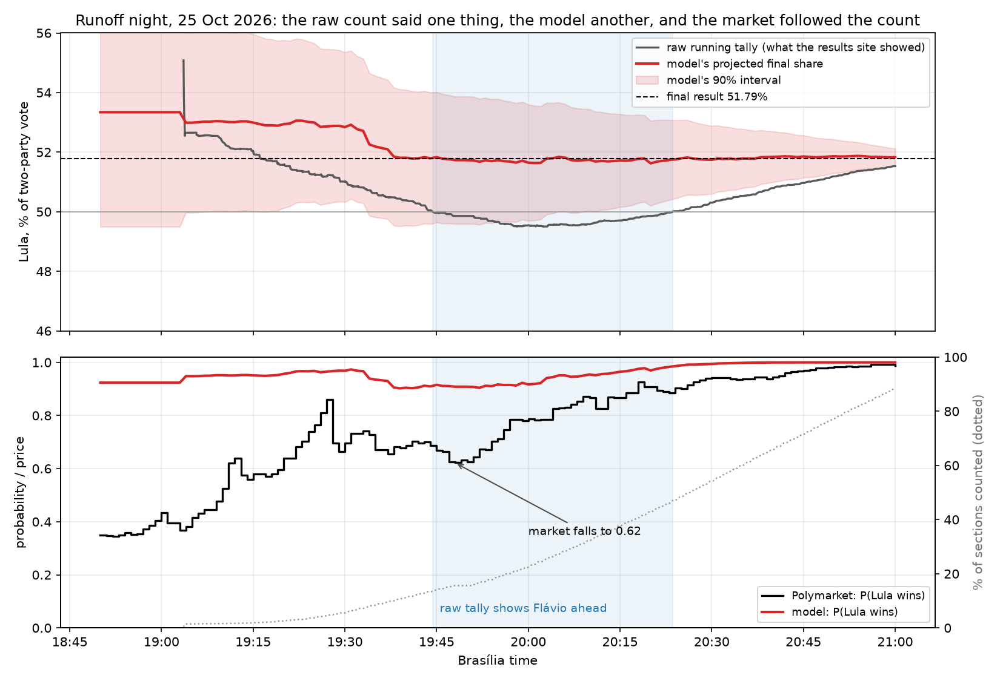
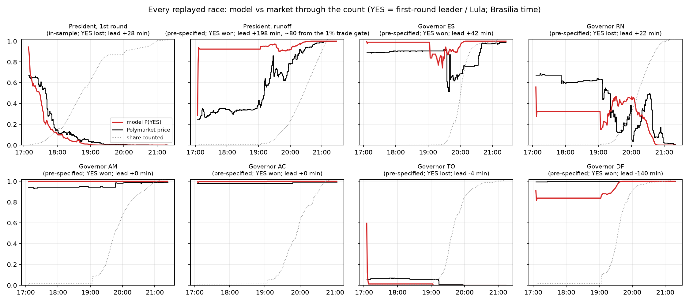
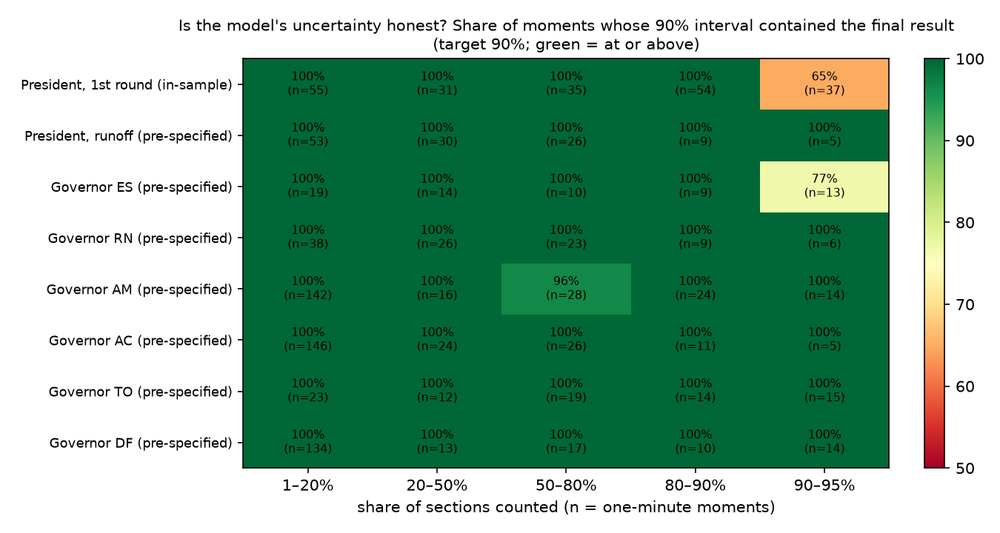
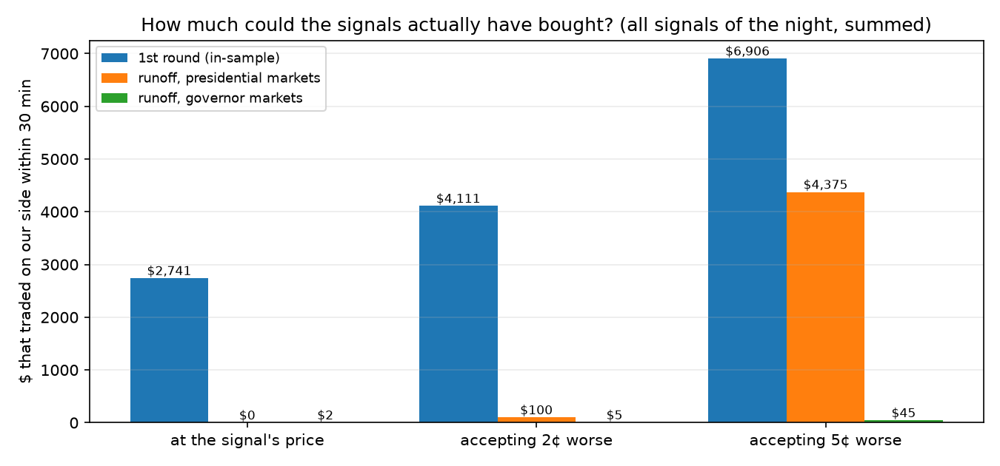

# Election review: how the count model has done, race by race

Every election the model has been run on, in one place. Each row says how much the result can be
trusted:

- **in-sample**: the model's settings were chosen on this same night, so it shows the method *can*
  work, not that it does;
- **pre-specified**: settings frozen and registered before the night's count data was examined, run
  once; the outcome was already known, so it tests the method, not a trading edge;
- **forward**: recorded live, before the outcome existed (none yet for a whole election night).

## Scoreboard

"Lead" is how many minutes before the market the model became (and stayed) at least 90% sure of the
eventual winner; positive means the model was first. Times are Brasília time. Interval coverage is
computed on one-minute moments between 1% and 95% counted (the registered looks used two-minute
steps; their figures, in [edge_tool.md](edge_tool.md), differ by a point or two).

| election | race | evidence | model ≥ 0.9 | market ≥ 0.9 | lead | 90% interval held | signals (won) | fillable in 30 min at signal / +5¢ |
|---|---|---|---|---|---|---|---|---|
| Brazil 2026, 1st round | President (national) | in-sample | 18:02 | 18:30 | **+28 min** | 94% | 7 (5)¹ | $2,741 / $6,906 |
| | 27 state markets | in-sample | | | ahead 6, tied 12, behind 9 | | | |
| Brazil 2026, runoff | President (national) | pre-specified | 17:06 | 20:24 | **+198 min** (~80 from the 1% trade gate) | 100% | 1 (1) | $0 / $4,375² |
| | 27 state markets | pre-specified | | | ahead 10, tied 12, behind 4 | | 11 (10) | (included above) |
| | Governor ES | pre-specified | 19:56 | 20:38 | **+42 min** | 95% | 1 (1) | $0 / $0 |
| | Governor RN (leader lost) | pre-specified | 20:36 | 20:58 | **+22 min** | 100% | 1 (1) | $2 / $45 |
| | Governor AM | pre-specified | 17:04 | 17:04 | 0 | 99.6% | 1 (1) | $0 / $0 |
| | Governor AC | pre-specified | 17:04 | 17:04 | 0 | 100% | 0 | – |
| | Governor TO (leader lost) | pre-specified | 17:08 | 17:04 | −4 | 100% | 0 | – |
| | Governor DF | pre-specified | 19:24 | 17:04 | **−140 min** | 100% | 0 | – |

¹ Favoured-side rule (only buy the side the model favours). ² Presidential markets, national + states.

**Reading it.** The model is earliest where the race is still open on the night: the runoff, ES and
RN. Where the market was already sure before counting began (AC, AM, TO) there is nothing to beat. It
is slow in a one-municipality race (DF), where comparing municipalities can't narrow its uncertainty.
In every race its 90% intervals contained the final result at least 94% of the time between 1% and 95%
counted; late in the first round they became too narrow (see the calibration chart). The tradable
money was a few thousand dollars per night, mostly in the national market and mostly in the first
minutes.

## What a count night looks like

*Top: the raw running tally (what the results site showed), the model's projected final share and its
90% interval, and the final result. Bottom: the market price and the model's probability, with the
share of sections counted (dotted). While the raw tally showed Flávio ahead (shaded), the market fell
to 0.62; the model, which accounts for which municipalities had reported, stayed above 0.9.*

## Every race

## Is the uncertainty honest?

## How much could actually have been traded?

*On the runoff nothing traded at the signal's price because the minute price history lagged real
trades by 2–4¢ in a fast market; accepting 5¢ worse, about $4,400 could have been bought.*

## Coming next

| election | what | status |
|---|---|---|
| Brazil 2022, both rounds | model only (Polymarket's 2022 market predates its current order book; no prices survive): how early and how accurately the model reads a count it never saw | section files available from TSE; configs to be frozen and registered before the count paths are examined |
| Brazil 2018, both rounds | model only, as above | section files available |
| Israel, Knesset, 2026-10-27 | count recorded live with order books for 74 markets | recorded; needs a seat-allocation model before it can be scored |
| US midterms, 2026-11-03 | official county feeds (CA, TX, OH, AK, GA) and order books for 257 markets, recorded live | scheduled |

Sources and method: [edge_tool.md](edge_tool.md). Registrations: [../prereg/NOTES.md](../prereg/NOTES.md).
