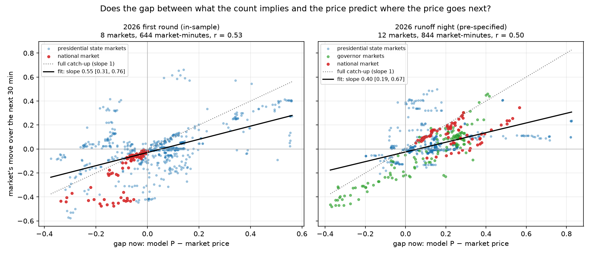
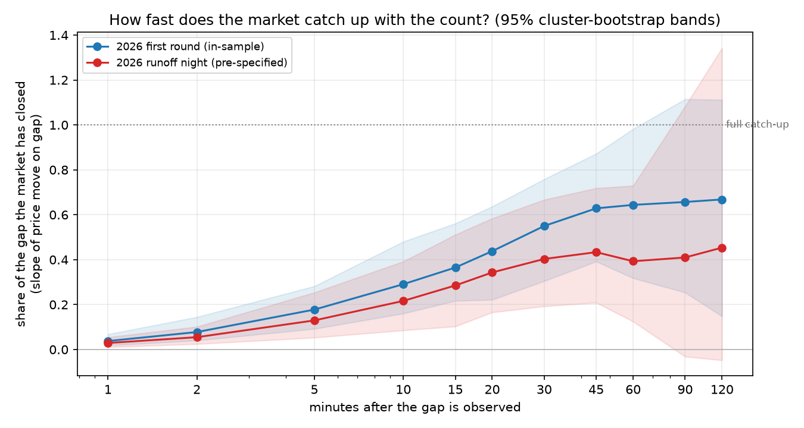
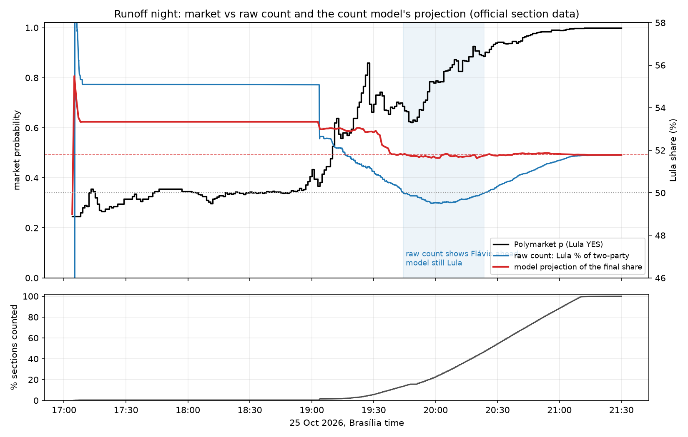
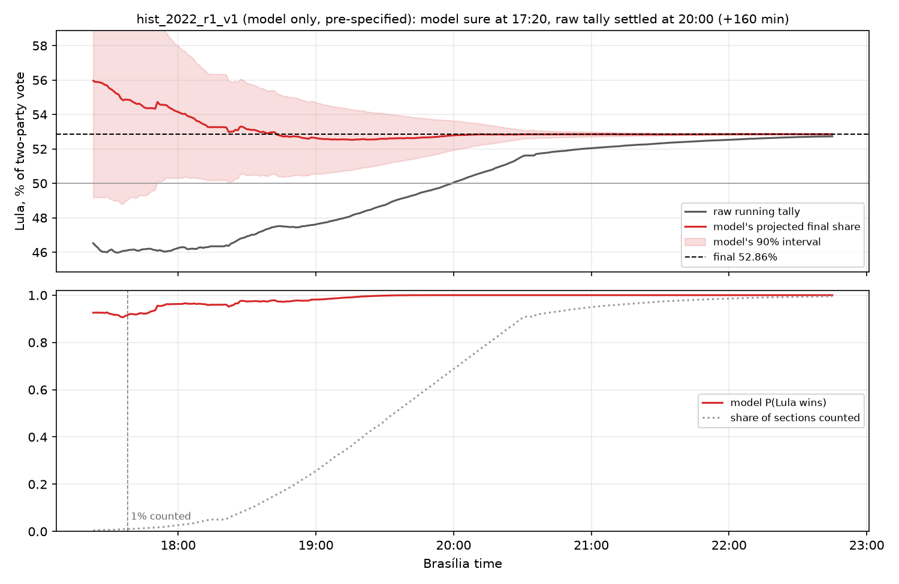
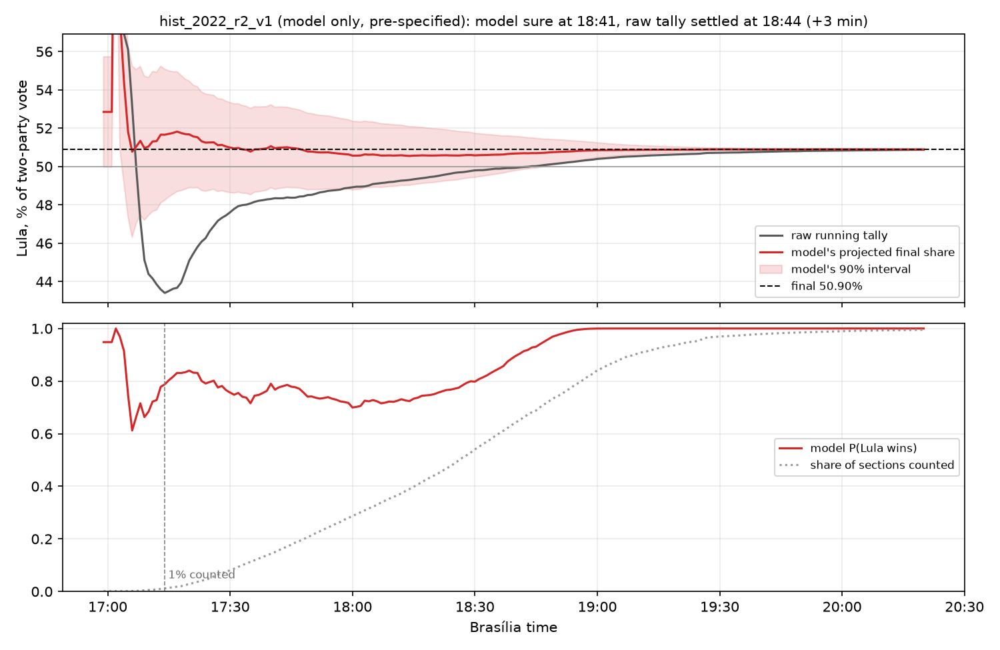

# Election review: how the count model has done, race by race

Every election the model has been run on, in one place. Each row says how much the result can be
trusted:

- **in-sample**: the model's settings were chosen on this same night, so it shows the method *can*
  work, not that it does;
- **pre-specified**: settings frozen and registered before the night's count data was examined, run
  once; the outcome was already known, so it tests the method, not a trading edge;
- **forward**: recorded live, before the outcome existed (none yet for a whole election night).

## How much does Polymarket underprice the count?

If the market had fully priced what the public count implied, the gap between the model and the price
would tell you nothing about where the price goes next. It does. Pooling every market and minute after
1% of that market's sections were counted, until it settled:

| night | markets | share of the gap the market closed after 5 / 10 / 30 / 60 min | 30-min slope, 95% CI |
|---|---|---|---|
| 2026 first round (in-sample) | 8 | 18% / 29% / 55% / 64% | 0.55 [0.31, 0.76] |
| 2026 runoff night (pre-specified) | 12 | 13% / 22% / 40% / 39% | 0.40 [0.19, 0.67] |

Read the 30-minute column as: half an hour after the count implied something the price didn't show,
the market had moved about 40–55% of the way there. The rest of the gap closed slowly or only once the
raw tally itself turned. CIs are a cluster bootstrap over (market, 30-minute block), because one-minute
windows overlap. The first round is in-sample (the model's settings were chosen on it); the runoff
night uses settings frozen beforehand.

## Scoreboard

"Lead" is how many minutes before the market the model became (and stayed) at least 90% sure of the
eventual winner; positive means the model was first. Times are Brasília time. Interval coverage is
computed on one-minute moments between 1% and 95% counted (the registered looks used two-minute
steps; their figures, in [edge_tool.md](edge_tool.md), differ by a point or two).

| election | race | evidence | model ≥ 0.9 | market ≥ 0.9 | lead | 90% interval held | signals (won) | fillable in 30 min at signal / +5¢ |
|---|---|---|---|---|---|---|---|---|
| Brazil 2026, 1st round | President (national) | in-sample | 18:02 | 18:30 | **+28 min** | 94% | 7 (5)¹ | $2,741 / $6,906 |
| | 27 state markets | in-sample | | | ahead 6, tied 12, behind 9 | | | |
| Brazil 2026, runoff | President (national) | pre-specified | 17:06 | 20:24 | **+198 min** (~80 from the 1% trade gate) | 100% | 1 (1) | $0 / $4,375² |
| | 27 state markets | pre-specified | | | ahead 10, tied 12, behind 4 | | 11 (10) | (included above) |
| | Governor ES | pre-specified | 19:56 | 20:38 | **+42 min** | 95% | 1 (1) | $0 / $0 |
| | Governor RN (leader lost) | pre-specified | 20:36 | 20:58 | **+22 min** | 100% | 1 (1) | $2 / $45 |
| | Governor AM | pre-specified | 17:04 | 17:04 | 0 | 99.6% | 1 (1) | $0 / $0 |
| | Governor AC | pre-specified | 17:04 | 17:04 | 0 | 100% | 0 | – |
| | Governor TO (leader lost) | pre-specified | 17:08 | 17:04 | −4 | 100% | 0 | – |
| | Governor DF | pre-specified | 19:24 | 17:04 | **−140 min** | 100% | 0 | – |

¹ Favoured-side rule (only buy the side the model favours). ² Presidential markets, national + states.

**Reading it.** The model is earliest where the race is still open on the night: the runoff, ES and
RN. Where the market was already sure before counting began (AC, AM, TO) there is nothing to beat. It
is slow in a one-municipality race (DF), where comparing municipalities can't narrow its uncertainty.
In every race its 90% intervals contained the final result at least 94% of the time between 1% and 95%
counted; late in the first round they became too narrow (see the calibration chart). The tradable
money was a few thousand dollars per night, mostly in the national market and mostly in the first
minutes.

One timing says a lot about how the runoff was priced: the raw running tally settled on Lula for good
at 20:24, and the market crossed 0.9 **in the same minute**. The market moved with the raw count, not
with what the count implied; the model had been above 0.9 since the first sections.

## What a count night looks like

*Top: the raw running tally (what the results site showed), the model's projected final share and its
90% interval, and the final result. Bottom: the market price and the model's probability, with the
share of sections counted (dotted). While the raw tally showed Flávio ahead (shaded), the market fell
to 0.62; the model, which accounts for which municipalities had reported, stayed above 0.9.*

## Every race

## Is the uncertainty honest?

## How much could actually have been traded?

*On the runoff nothing traded at the signal's price because the minute price history lagged real
trades by 2–4¢ in a fast market; accepting 5¢ worse, about $4,400 could have been bought.*

## Brazil 2022: model only, on counts it never saw

No Polymarket prices survive for 2022, so there is no market to compare against. Instead the
benchmark is the raw running tally on the electoral court's site: when did the model become sure of
the winner, and when did the raw tally settle on that winner for good? Both configs were frozen and
registered before the 2022 section files were downloaded, with settings copied unchanged from the
2026 runoff config; each was run once.

| race | final (Lula, two-party) | model ≥ 0.9 | raw tally settled | lead | error at 5% counted: model / raw | 90% interval held (1–95% counted) |
|---|---|---|---|---|---|---|
| 2022, 1st round | 52.86% | 17:20 (0.4% counted) | 20:00 (69% counted) | **+160 min** (142 from 1% counted) | +0.4 / −6.5 pts | 100% |
| 2022, runoff | 50.90% | 18:41 (65% counted) | 18:44 (68% counted) | **+3 min** | +0.4 / −4.0 pts | 100% |

In the first round the raw tally showed Bolsonaro ahead for almost three hours (the early count was
heavy with states that lean to him), while the model's estimate was within 2 points of the final at
1% counted and within half a point by 5%. In the runoff, the closest race in this review (50.9%), the model's
estimate was again far more accurate early (error 0.8 vs 7.5 points at 1% counted) but it stayed honest
about a near coin flip and only became sure 3 minutes before the raw tally settled.

**Brazil 2018 cannot be replayed:** its section files record when each ballot box closed, not when its
result reached the court, so the order in which the count arrived is unknown. The registered 2018
configs were not run.

## Coming next

| election | what | status |
|---|---|---|
| Brazil 2018, both rounds | model only | not possible: the 2018 files have no receipt times |
| Israel, Knesset, 2026-10-27 | count recorded live with order books for 74 markets | recorded; needs a seat-allocation model before it can be scored |
| US midterms, 2026-11-03 | official county feeds (CA, TX, OH, AK, GA) and order books for 257 markets, recorded live | scheduled |

Sources and method: [edge_tool.md](edge_tool.md). Registrations: [../prereg/NOTES.md](../prereg/NOTES.md).
